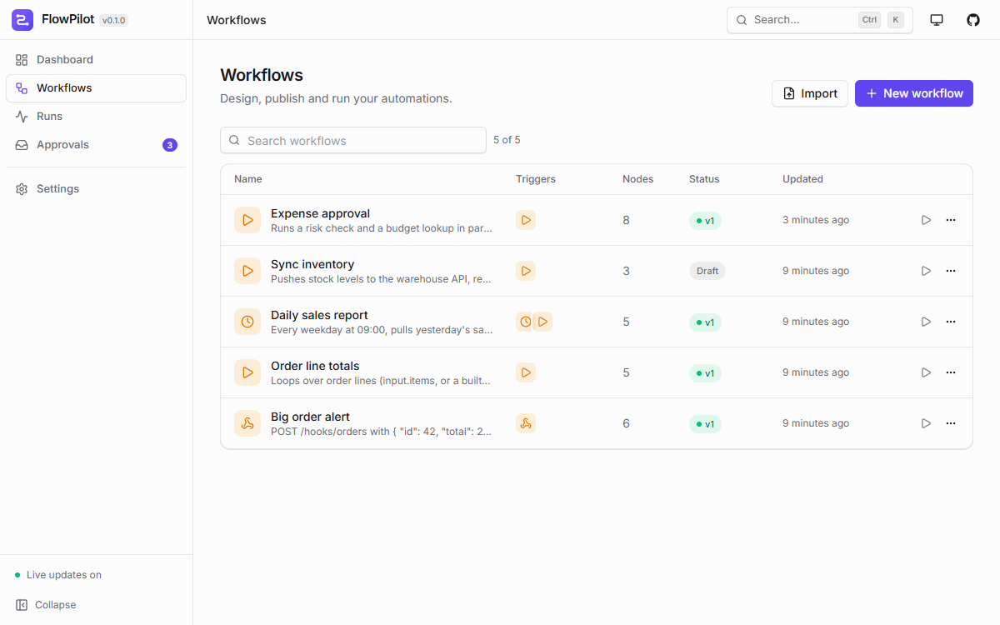
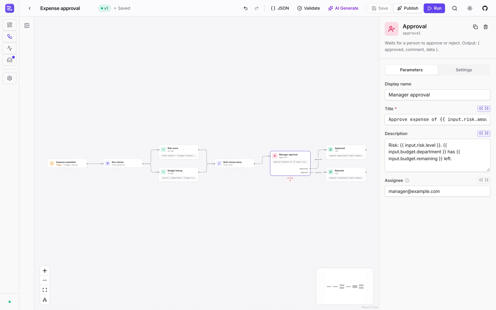
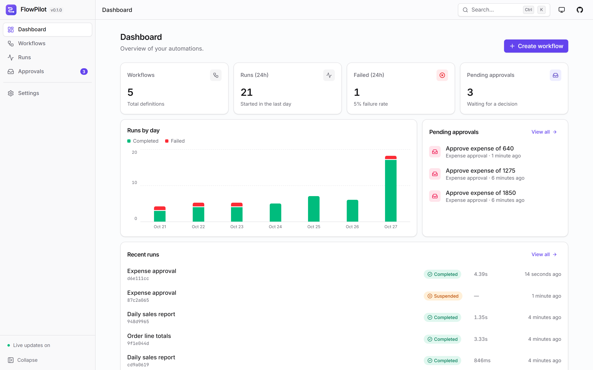
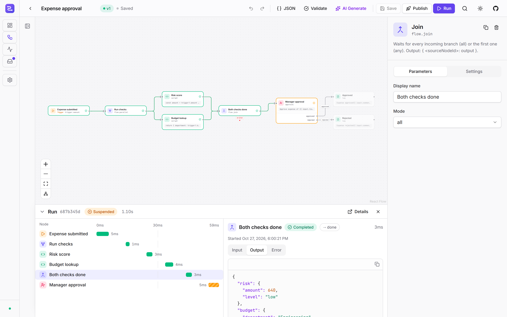
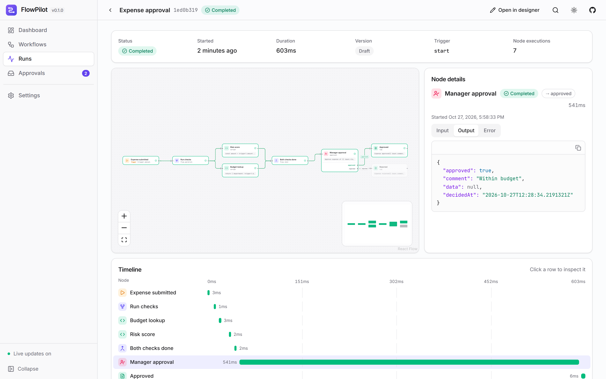
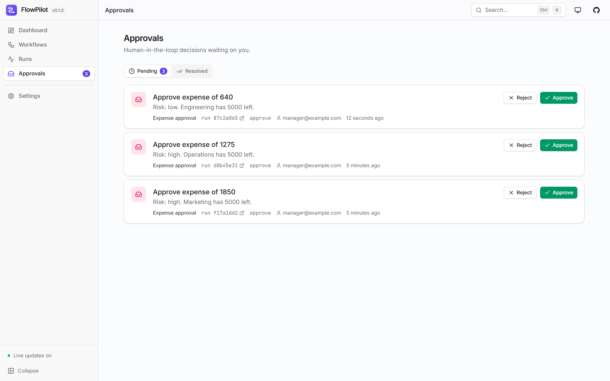
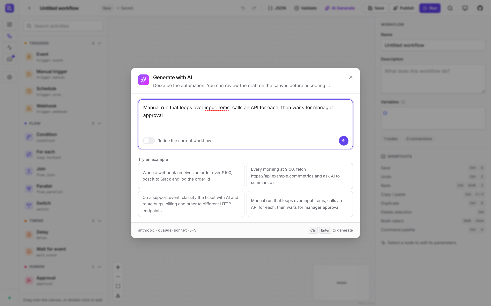
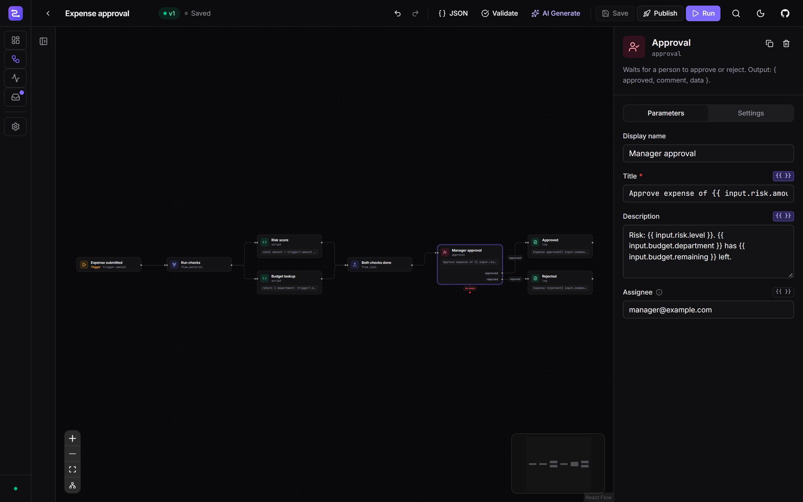
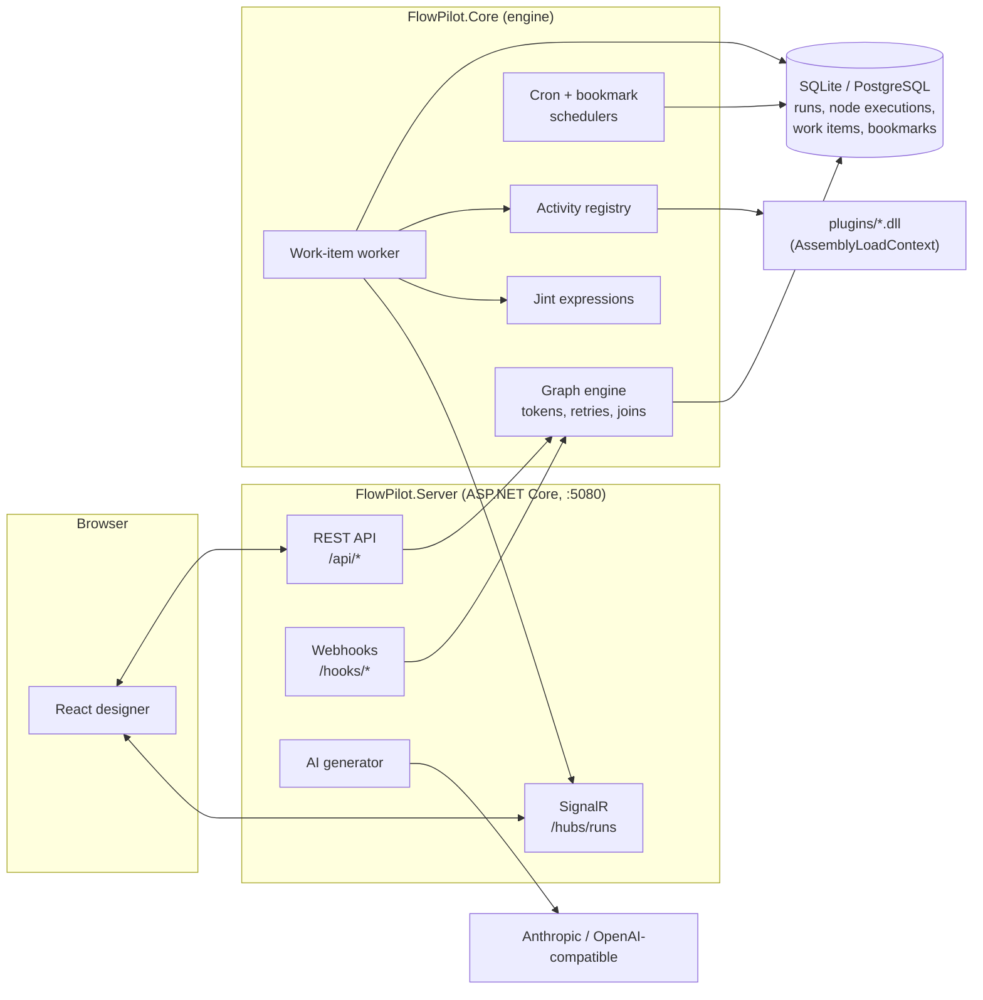

<div align="center">


# FlowPilot

**Open-source n8n alternative for .NET — visual workflows, durable execution and AI, self-hosted.**

[](https://github.com/ommistry-hue/flowpilot/actions/workflows/ci.yml)
[](LICENSE)
[](https://dotnet.microsoft.com/)
[](CONTRIBUTING.md)
[](https://github.com/ommistry-hue/flowpilot/stargazers)

[Quickstart](#quickstart) ·
[Setup guide](#setup-guide) ·
[Docs](docs/architecture.md) ·
[Write an activity](docs/writing-activities.md) ·
[Examples](examples/) ·
[Roadmap](ROADMAP.md) ·
[Discussions](https://github.com/ommistry-hue/flowpilot/discussions)

<!-- TODO: record a 15–20s demo (prompt -> generated workflow -> run with live node status), save it as docs/assets/demo.gif, then swap it in for the screenshot below. -->
<!--  -->


**⭐ If FlowPilot looks useful, [star the repo](https://github.com/ommistry-hue/flowpilot/stargazers). It helps other .NET developers find it.**

</div>

---

FlowPilot is a workflow automation platform you run yourself. Draw workflows in the browser, or describe them in plain English and let an LLM draft the graph. Runs are checkpointed to SQLite or PostgreSQL after every step, so they survive restarts, wait days for an approval, and retry with backoff. It is a single .NET 10 process: run the Docker image, or embed the engine in your own ASP.NET Core app with `AddFlowPilot()`.

<details>
<summary><b>Table of contents</b></summary>

- [Quickstart](#quickstart)
- [Screenshots](#screenshots)
- [Features](#features)
- [Why FlowPilot](#why-flowpilot)
- [Setup guide](#setup-guide)
  - [Prerequisites](#prerequisites)
  - [Option A: Docker Compose (PostgreSQL)](#option-a-docker-compose-postgresql)
  - [Option B: single container (SQLite)](#option-b-single-container-sqlite)
  - [Option C: from source](#option-c-from-source)
  - [Your first workflow](#your-first-workflow)
  - [Enable AI generation](#enable-ai-generation)
  - [Install a plugin](#install-a-plugin)
  - [Switch to PostgreSQL](#switch-to-postgresql)
  - [Set an API key](#set-an-api-key)
  - [Run the tests](#run-the-tests)
  - [Troubleshooting](#troubleshooting)
- [Architecture](#architecture)
- [A workflow is JSON](#a-workflow-is-json)
- [Write a custom activity in 10 lines](#write-a-custom-activity-in-10-lines)
- [Embed in your ASP.NET Core app](#embed-in-your-aspnet-core-app)
- [Configuration](#configuration)
- [Roadmap](#roadmap)
- [Contributing](#contributing)
- [Community](#community)
- [Built with](#built-with)
- [License](#license)

</details>

## Quickstart

```bash
git clone https://github.com/ommistry-hue/flowpilot.git && cd flowpilot
cp .env.example .env     # then set FLOWPILOT_API_KEY (and POSTGRES_PASSWORD)
docker compose up -d
```

Open **http://localhost:5080** and enter your API key when asked. Prefer one container and SQLite?

```bash
docker run -d --name flowpilot -p 5080:5080 -v flowpilot-data:/data \
  -e FlowPilot__ApiKey=change-me ghcr.io/ommistry-hue/flowpilot:latest
```

Hacking on it? `dotnet run --project src/FlowPilot.Server` plus `cd web && npm i && npm run dev`. Full details in the [setup guide](#setup-guide).

## Screenshots

| | |
|---|---|
| <br/><sub>**Dashboard.** Workflows, runs in the last 24 hours, failures and pending approvals at a glance.</sub> | <br/><sub>**Designer.** Drag activities from the palette (folded away here), connect outcomes, edit typed config in the side panel.</sub> |
| <br/><sub>**Live run.** Node status streams in over SignalR while the run executes.</sub> | <br/><sub>**Run detail.** Inputs, outputs, attempts, timings and errors for every node. Cancel or retry from here.</sub> |
| <br/><sub>**Approvals.** Suspended runs wait here until someone approves or rejects them.</sub> | <br/><sub>**AI generation.** Describe a workflow in plain English and get a validated, laid-out graph.</sub> |
| <br/><sub>**Dark mode.** The whole UI, in the dark.</sub> | |

## Features

- **Visual designer.** Drag nodes, connect outcomes, edit config in a typed side panel. Changes save as a draft; publish creates an immutable version.
- **Durable execution.** Every node execution is a checkpoint in the database. A crash mid-run resumes from the last committed step (at-least-once delivery).
- **Retries and error paths.** Per-node retry policy with exponential backoff. When retries run out, the run follows the node's `error` edge or fails.
- **Human-in-the-loop.** `approval` suspends a run until someone approves or rejects it in the UI or via the API.
- **Long waits for free.** `delay` and `wait.event` park the run as a bookmark. Nothing holds a thread while it waits.
- **Branching, loops, parallelism.** `condition`, `switch`, `loop.forEach`, `flow.parallel` and `flow.join` (all/any), with token-based graph semantics.
- **Triggers.** Manual, webhook (`/hooks/{path}`, optionally authenticated with a shared secret or a GitHub-style HMAC signature), cron (with timezones) and named events.
- **Secrets.** `FLOWPILOT_SECRET_*` environment variables become `{{ secrets.NAME }}` in expressions, masked as `***` in run history and logs.
- **JavaScript expressions.** `{{ input.body.total > 100 }}` anywhere in config, in a Jint sandbox with time, memory and statement limits.
- **AI built in.** Generate or edit a whole workflow from a prompt. Call an LLM from any workflow with the `ai.prompt` node. Works with Anthropic or any OpenAI-compatible API, including Ollama and OpenRouter.
- **Live run view.** Node status, inputs and outputs stream to the browser over SignalR as the run executes.
- **Plugin SDK.** Write an activity as one C# class. Drop the DLL into `plugins/`; each plugin loads in its own `AssemblyLoadContext`.
- **Embeddable.** `FlowPilot.Core` is a library. Add the engine to an existing ASP.NET Core app with one call.
- **Small footprint.** One process, one SQLite file by default. PostgreSQL when you need it.

### Built-in activities

| Category | Activities |
|---|---|
| Triggers | `trigger.manual`, `trigger.webhook`, `trigger.cron`, `trigger.event` |
| Flow | `condition`, `switch`, `loop.forEach`, `flow.parallel`, `flow.join` |
| Durable waits | `delay`, `approval`, `wait.event` |
| Data | `variable.set`, `script`, `log` |
| Integrations | `http.request`, `ai.prompt` |

## Why FlowPilot

|  | **FlowPilot** | n8n | Elsa 3 | Temporal | Activepieces |
|---|---|---|---|---|---|
| License | Apache-2.0 | Sustainable Use License (fair-code, not OSI) | MIT | MIT | MIT core + commercial EE |
| .NET-native | Yes | No (Node.js) | Yes | .NET SDK; server is Go | No (Node.js) |
| Embeddable in your app | Yes (`AddFlowPilot()`) | No | Yes | No (needs a Temporal cluster) | No |
| Visual designer | Yes | Yes | Yes (Elsa Studio) | No (code-first; UI for observing runs) | Yes |
| Durable execution | Yes (DB checkpoints, bookmarks) | Partial (persisted executions, Wait node, queue mode) | Yes (bookmarks) | Yes (event-sourced history) | Partial (pause/resume, queue) |
| Prompt-to-workflow AI | Yes | Yes (AI Workflow Builder) | No | No | Partial (AI copilot) |
| Minimal footprint | 1 process + SQLite file | 1 process + DB; Redis for queue mode | 1 process + DB; Studio separate | Server cluster + DB | App + PostgreSQL + Redis |

Pick **Temporal** for code-first, high-scale durable execution across many languages. Pick **n8n** or **Activepieces** for the largest catalogue of SaaS integrations today. Pick **Elsa** for a mature .NET workflow library. Pick **FlowPilot** for a visual designer, durable runs and AI generation in one Apache-2.0 .NET process that you can also embed.

<sub>Comparison reflects public docs at the time of writing. Spot something wrong? Open a PR.</sub>

## Setup guide

### Prerequisites

| Tool | Version | Needed for |
|---|---|---|
| [Docker](https://docs.docker.com/get-docker/) + Compose v2 | 24+ | Options A and B (optional otherwise) |
| [.NET SDK](https://dotnet.microsoft.com/download) | 10.0 | Option C, plugins, tests |
| [Node.js](https://nodejs.org/) | 24 | Option C (the designer) |
| Git | any | Cloning the repo |

### Option A: Docker Compose (PostgreSQL)

The recommended way to run FlowPilot on a server.

```bash
git clone https://github.com/ommistry-hue/flowpilot.git
cd flowpilot
cp .env.example .env     # set FLOWPILOT_API_KEY and POSTGRES_PASSWORD; AI keys are optional
docker compose up -d
docker compose ps        # wait until flowpilot is "healthy"
```

Open **http://localhost:5080** and enter the API key. Compose refuses to start until `FLOWPILOT_API_KEY` is set. Data lives in the `postgres-data` volume. Plugins are read from `./plugins`.

### Option B: single container (SQLite)

```bash
docker run -d --name flowpilot -p 5080:5080 -v flowpilot-data:/data \
  -e FlowPilot__ApiKey=change-me ghcr.io/ommistry-hue/flowpilot:latest
```

Replace `change-me` with a long random value, such as the output of `openssl rand -hex 32`. Without a key, the server logs a warning at startup and anyone who can reach the port controls it. The database is `/data/flowpilot.db` inside the `flowpilot-data` volume. Add AI variables or `FLOWPILOT_SECRET_*` secrets with more `-e` flags. Mount plugins with `-v ./plugins:/app/plugins:ro`. The image sets `FlowPilot__Http__BlockPrivateNetworks=true`, so `http.request` cannot reach private addresses. Set it to `false` if your workflows call internal services.

### Option C: from source

Works the same on Windows, macOS and Linux.

```bash
git clone https://github.com/ommistry-hue/flowpilot.git
cd flowpilot
```

Terminal 1, the API and engine on **http://localhost:5080**:

```bash
dotnet run --project src/FlowPilot.Server
```

Terminal 2, the designer with hot reload on **http://localhost:5173**:

```bash
cd web
npm i
npm run dev
```

Use **http://localhost:5173** while developing. Vite proxies `/api`, `/hooks`, `/hubs` and `/health` to port 5080. The SQLite file `flowpilot.db` is created on first start.

To serve the built UI from the .NET server instead (one port, like production), run `npm run build` in `web/`. It writes to `src/FlowPilot.Server/wwwroot`.

### Your first workflow

A webhook that posts large orders to another service.

1. **Open the designer** at http://localhost:5080 (or :5173 from source) and create a workflow.
2. **Add a Webhook trigger.** Drag *Webhook* onto the canvas. Set `path` to `orders` and `method` to `POST`.
3. **Add a Condition.** Connect the trigger's `done` handle to it. Set `expression` to `input.body.total > 100`.
4. **Add an HTTP request.** Connect the condition's `true` handle to it. Set `url` to a test endpoint such as a [webhook.site](https://webhook.site) URL, `method` to `POST`, and `body` to `{{ ({ text: 'Big order ' + input.body.id }) }}`.
5. **Publish, then call it.** Webhooks only fire for published workflows.

```bash
curl -X POST http://localhost:5080/hooks/orders \
  -H "Content-Type: application/json" \
  -d '{"id": "A-1001", "total": 250}'
```

On Windows PowerShell, call `curl.exe` rather than `curl`, and wrap the JSON in single quotes as shown. The response is `202` with the new run IDs. Open **Runs** to watch each node complete.

**Next: add a human step.** Put an `approval` node between the condition and the HTTP request, connect its `approved` handle onward, and run it again. The run shows as *Suspended* and appears in **Approvals**. Approve it there, or call `POST /api/approvals/{bookmarkId}/approve`, and the run continues. [`examples/order-approval.json`](examples/order-approval.json) is a fuller version with parallel checks.

### Enable AI generation

Set a provider and key, then restart. Docker Compose reads them from `.env`.

```bash
# bash / zsh
export FlowPilot__AI__Provider=anthropic
export FlowPilot__AI__ApiKey=sk-ant-...
export FlowPilot__AI__Model=claude-sonnet-5-5
```

```powershell
# PowerShell
$env:FlowPilot__AI__Provider = "anthropic"
$env:FlowPilot__AI__ApiKey   = "sk-ant-..."
$env:FlowPilot__AI__Model    = "claude-sonnet-5-5"
```

For OpenAI, Ollama, OpenRouter or another OpenAI-compatible API, use `FlowPilot__AI__Provider=openai` and set `FlowPilot__AI__BaseUrl` (for example `http://localhost:11434/v1` for Ollama). Check `GET /api/ai/status`; it returns `enabled: true` when configured. This also enables the `ai.prompt` node.

### Install a plugin

Build the sample plugin into its own folder under `plugins/`. The folder name matches the assembly name.

```bash
dotnet publish samples/FlowPilot.Plugins.Sample -c Release -o plugins/FlowPilot.Plugins.Sample
```

Point the server at that folder and restart:

```bash
FlowPilot__PluginsPath="$PWD/plugins" dotnet run --project src/FlowPilot.Server
```

With Docker Compose, `./plugins` is already mounted at `/app/plugins`; run `docker compose restart flowpilot`. The new activities appear in the designer palette. Writing your own: [docs/writing-activities.md](docs/writing-activities.md).

### Switch to PostgreSQL

```bash
export FlowPilot__Database__Provider=postgres
export ConnectionStrings__FlowPilot="Host=localhost;Port=5432;Database=flowpilot;Username=flowpilot;Password=flowpilot"
```

Need a local database? `docker compose up -d postgres` starts the bundled one, though it does not publish port 5432 by default. Add `ports: ["5432:5432"]` to the `postgres` service to reach it from the host. Tables are created on first start. SQLite data is not migrated automatically.

### Set an API key

```bash
export FlowPilot__ApiKey=$(openssl rand -hex 32)
```

Every `/api/*` and `/hubs/*` request then needs the key:

```bash
curl http://localhost:5080/api/workflows -H "X-Api-Key: $FlowPilot__ApiKey"
```

`/hooks/*` and `/health` stay open. To authenticate webhook callers, set the trigger's **Shared secret**: callers must then send it in `X-FlowPilot-Secret` or sign the body GitHub-style (`X-Hub-Signature-256`). See [SECURITY.md](SECURITY.md) for a hardening checklist.

### Use secrets in workflows

Set environment variables named `FLOWPILOT_SECRET_<NAME>` and reference them as `{{ secrets.NAME }}`, for example in an HTTP header or as a webhook's shared secret. The values never appear in the workflow JSON, and they are masked as `***` in run history and logs. See [docs/expressions.md](docs/expressions.md#secrets).

### Run the tests

```bash
dotnet test FlowPilot.slnx
cd web && npm run lint && npm run build
```

The engine tests also run against PostgreSQL when `FLOWPILOT_TEST_POSTGRES` holds a connection string, for example `Host=localhost;Username=postgres;Password=postgres`. Each test creates and drops its own database. CI runs them against `postgres:17`.

### Troubleshooting

<details>
<summary><b>Port 5080 or 5173 is already in use</b></summary>

Run the server on another port with `dotnet run --project src/FlowPilot.Server --urls http://localhost:5081`, or set `ASPNETCORE_URLS`. For Docker, change the host side of the mapping: `-p 8080:5080`. For Vite, use `npm run dev -- --port 5174`. If you move the server, update the proxy target in `web/vite.config.ts`.
</details>

<details>
<summary><b>"database is locked" (SQLite)</b></summary>

Another process holds `flowpilot.db`, often a second server instance or a DB browser with an open write transaction. Stop it and restart. Keep the file on a local disk, not a network share. For several instances or heavy run volume, [switch to PostgreSQL](#switch-to-postgresql).
</details>

<details>
<summary><b>AI generation is disabled or hidden</b></summary>

`GET /api/ai/status` returns `enabled: false` when `FlowPilot:AI:Provider` or `FlowPilot:AI:ApiKey` is missing. Check the variable names use double underscores (`FlowPilot__AI__ApiKey`), then restart. With Docker Compose, check `.env` sits next to `docker-compose.yml` and run `docker compose up -d` again. For Ollama in Docker, use `host.docker.internal` instead of `localhost` in `BaseUrl`.
</details>

<details>
<summary><b>CORS errors in development</b></summary>

Open the UI at **http://localhost:5173**, not by pointing a page at port 5080 directly. The Vite dev server proxies `/api`, `/hooks`, `/hubs` and `/health` to the backend, so the browser only talks to one origin. In production the server serves the UI itself, so there is no cross-origin traffic.
</details>

<details>
<summary><b>The webhook returns 404</b></summary>

`/hooks/*` only matches **published** workflows. Publish the workflow, and check the path and method match the trigger config.
</details>

<details>
<summary><b>Cron trigger never fires</b></summary>

Cron triggers run for published workflows only. Check the expression and `timezone`, and remember the server clock is UTC unless you set a timezone.
</details>

## Architecture



More detail in [docs/architecture.md](docs/architecture.md).

## A workflow is JSON

```json
{
  "schemaVersion": "1",
  "name": "New order -> Slack",
  "nodes": [
    { "id": "trigger1", "type": "trigger.webhook", "config": { "path": "orders", "method": "POST" } },
    { "id": "check", "type": "condition", "config": { "expression": "input.body.total > 100" } },
    { "id": "notify", "type": "http.request",
      "config": { "url": "https://hooks.slack.com/services/XXX", "method": "POST",
                  "body": "{{ ({ text: 'Big order ' + input.body.id }) }}" },
      "retry": { "maxAttempts": 3, "initialDelayMs": 1000, "backoffMultiplier": 2, "maxDelayMs": 60000 } }
  ],
  "edges": [
    { "id": "e1", "source": "trigger1", "sourceHandle": "done", "target": "check" },
    { "id": "e2", "source": "check", "sourceHandle": "true", "target": "notify" }
  ]
}
```

Definitions are plain JSON, so they diff cleanly in Git. See [docs/workflow-schema.md](docs/workflow-schema.md) and [docs/expressions.md](docs/expressions.md).

## Write a custom activity in 10 lines

```csharp
using System.Text.Json.Nodes;
using FlowPilot.Abstractions;

[Activity("text.reverse", DisplayName = "Reverse text", Category = "Text")]
public sealed class ReverseText : IActivity
{
    [Input(Required = true)] public string Text { get; set; } = "";

    public Task<ActivityResult> ExecuteAsync(ActivityContext context, CancellationToken ct) =>
        Task.FromResult(ActivityResult.Done(new JsonObject { ["result"] = new string(Text.Reverse().ToArray()) }));
}
```

It appears in the designer palette with a typed `text` input. Ship it as a plugin DLL or register it in code. Full guide: [docs/writing-activities.md](docs/writing-activities.md).

## Embed in your ASP.NET Core app

```csharp
using FlowPilot.Core;

var builder = WebApplication.CreateBuilder(args);

builder.Services.AddFlowPilot()
    .AddActivity<ReverseText>();

var app = builder.Build();
app.Run();
```

The engine reads the same configuration keys as the server (below), so `ConnectionStrings:FlowPilot` and `FlowPilot:Database:Provider` decide where runs are stored. Use `FlowPilot.Server` as the reference host for the HTTP API, SignalR hub and UI.

## Configuration

Set values in `appsettings.json` or as environment variables (`:` becomes `__`, e.g. `FlowPilot__AI__ApiKey`).

| Key | Default | Description |
|---|---|---|
| `FlowPilot:Database:Provider` | `sqlite` | `sqlite` or `postgres` |
| `ConnectionStrings:FlowPilot` | `Data Source=flowpilot.db` | Database connection string |
| `FlowPilot:PluginsPath` | `./plugins` | Folder scanned for plugin DLLs |
| `FlowPilot:ApiKey` | — | When set, `/api/*` and `/hubs/*` require the `X-Api-Key` header. `/hooks/*` and `/health` stay open |
| `FlowPilot:AI:Provider` | — | `anthropic` or `openai` (any OpenAI-compatible API) |
| `FlowPilot:AI:ApiKey` | — | Provider API key |
| `FlowPilot:AI:Model` | `claude-sonnet-5-5` | Model name |
| `FlowPilot:AI:BaseUrl` | — | Custom endpoint, e.g. Ollama or OpenRouter |
| `FlowPilot:AI:AnthropicVersion` | `2026-10-21` | `anthropic-version` header sent to the Messages API |
| `FlowPilot:Engine:Workers` | CPU count × 2 (min 4) | Work items executed concurrently per process |
| `FlowPilot:Engine:MaxStepsPerRun` | `10000` | A run that executes more nodes fails, which stops runaway loops |
| `FlowPilot:Http:BlockPrivateNetworks` | `false` (`true` in the Docker image) | Stop `http.request` from reaching loopback, private and link-local addresses |
| `FlowPilot:Http:MaxResponseBytes` | `10485760` | Larger HTTP responses fail the node |
| `FlowPilot:Webhooks:MaxBodyBytes` | `1048576` | Larger webhook bodies get 413 |
| `FlowPilot:Retention:Days` | `30` | Completed, failed and cancelled runs older than this are deleted; `0` keeps them |
| `FLOWPILOT_SECRET_<NAME>` | — | Environment variables exposed to expressions as `secrets.NAME`, masked in history and logs |

Without AI settings, FlowPilot runs normally and hides the AI features.

## Roadmap

Highlights from [ROADMAP.md](ROADMAP.md):

- EF Core migrations
- RBAC and SSO — **free and OSI-licensed, forever**
- Secrets vault integrations (beyond environment variables) and Git sync for workflows
- MCP / agent tool-calling node and sub-workflows
- Multi-node scaling with PostgreSQL `LISTEN/NOTIFY`
- OpenTelemetry tracing, NuGet packages, hosted demo

## Contributing

Issues, activities and docs fixes are all welcome. Start with [CONTRIBUTING.md](CONTRIBUTING.md).

**Good first issues:** browse [`good first issue`](https://github.com/ommistry-hue/flowpilot/labels/good%20first%20issue). Most are new activities (Slack, Discord, SMTP, PostgreSQL query and more): one class and one test each.

### Contributors

<a href="https://github.com/ommistry-hue/flowpilot/graphs/contributors">
  
</a>

## Community

- **[GitHub Discussions](https://github.com/ommistry-hue/flowpilot/discussions)**: questions, ideas, and show-and-tell for your workflows and plugins
- **Discord**: [join the server](https://discord.gg/INVITE_CODE) <!-- TODO: replace with the real invite -->
- **Issues**: [bugs and feature requests](https://github.com/ommistry-hue/flowpilot/issues/new/choose)
- **Security**: report privately, see [SECURITY.md](SECURITY.md)

## Sponsors

FlowPilot is built in the open by volunteers. Sponsorship pays for CI, the hosted demo and maintainer time.

<!-- TODO: enable GitHub Sponsors and add sponsor logos here. -->
[Become a sponsor](https://github.com/sponsors/ommistry-hue)

## Built with

- [.NET 10](https://dotnet.microsoft.com/) and [ASP.NET Core](https://learn.microsoft.com/aspnet/core): host, REST API and background workers
- [Entity Framework Core](https://learn.microsoft.com/ef/core/): persistence for [SQLite](https://www.sqlite.org/) and [PostgreSQL](https://www.postgresql.org/)
- [SignalR](https://learn.microsoft.com/aspnet/core/signalr/introduction): live run updates
- [Jint](https://github.com/sebastienros/jint): sandboxed JavaScript expressions
- [Cronos](https://github.com/HangfireIO/Cronos): cron parsing with time zones
- [React](https://react.dev/), [TypeScript](https://www.typescriptlang.org/) and [Vite](https://vite.dev/): the designer

## Star history

<a href="https://star-history.com/#ommistry-hue/flowpilot&Date">
  <picture>
    <source media="(prefers-color-scheme: dark)" srcset="https://api.star-history.com/svg?repos=ommistry-hue/flowpilot&type=Date&theme=dark" />
    
  </picture>
</a>

**⭐ Enjoying FlowPilot? [Give it a star](https://github.com/ommistry-hue/flowpilot/stargazers) and tell a .NET friend.**

## License

[Apache-2.0](LICENSE). Use it at work, embed it in commercial products, fork it. No usage restrictions.
