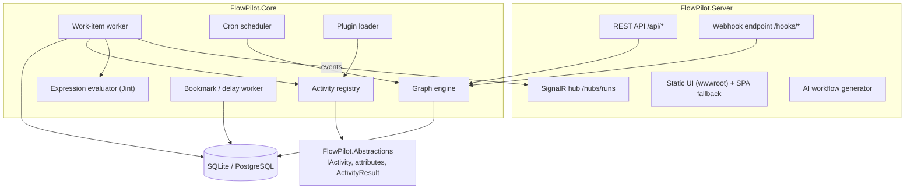
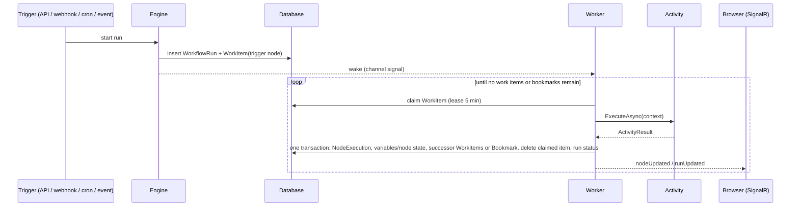

# Architecture

FlowPilot is one .NET 10 process backed by one database. This page explains how the pieces fit and what happens during a run. The normative details are in [SPEC.md](SPEC.md).

## Components

| Project | Responsibility |
|---|---|
| `FlowPilot.Abstractions` | The plugin SDK. `IActivity`, `[Activity]`, `[Input]`, `ActivityContext`, `ActivityResult`, bookmarks and the workflow model. Small and stable; plugins depend only on this. |
| `FlowPilot.Core` | The engine: persistence (EF Core), graph semantics, the worker, schedulers, expressions, built-in activities, plugin loading. Registered with `services.AddFlowPilot()`. |
| `FlowPilot.Server` | The ASP.NET Core host. REST API, webhooks, SignalR, AI generation, optional API-key auth, and the built React UI. |
| `web/` | The React designer. Built into `FlowPilot.Server/wwwroot` for production; runs on Vite (port 5173) in development, proxying to 5080. |

## Data model

Every piece of run state lives in the database, so any process can pick up any run.

| Table | Purpose |
|---|---|
| `WorkflowDefinitions` | The editable draft of each workflow, plus a pointer to its published version |
| `WorkflowVersions` | Immutable published snapshots. Triggers (webhook, cron, event) only fire published versions |
| `WorkflowRuns` | One row per run: status, input, variables, per-node state, outputs, error. Holds a snapshot of the definition it runs, so editing a workflow never changes runs in flight |
| `NodeExecutions` | One row per node attempt. It is both the run history shown in the UI and the checkpoint the engine resumes from |
| `WorkItems` | The queue. Each row is "run node X of run Y with this input", with a lease |
| `Bookmarks` | Parked nodes waiting for an approval, a timer or an event |
| `ScheduleStates` | Next fire time for each cron trigger |

## Lifecycle of a run

1. **Start.** A trigger creates a `WorkflowRun` and a work item for the trigger node. The trigger node's output is the trigger payload.
2. **Claim.** The worker keeps up to `FlowPilot:Engine:Workers` items in flight. It polls every 500 ms and is also woken in-process as soon as a commit creates new work. It claims as many ready items as it has free slots, atomically: `FOR UPDATE SKIP LOCKED` on PostgreSQL, `UPDATE ... RETURNING` on SQLite. While an activity runs, its lease is renewed.
3. **Execute.** Config values containing `{{ }}` are evaluated, `[Input]` properties are bound, and the activity runs.
4. **Commit.** One transaction records the node execution, merges variable and node-state changes (optimistic concurrency, retried on conflict), enqueues successors or creates a bookmark, deletes the claimed item and updates the run status.
5. **Route.** For outcome `X`, every edge from the node with `sourceHandle == X` produces a token for its target. Several such edges means parallel branches.
6. **Finish.** The run completes when no tokens, work items or bookmarks remain.

## Durability guarantees

- **At-least-once delivery.** If the process dies after an activity runs but before the commit, the lease expires and the item runs again. Make side-effecting activities idempotent where you can, for example with an idempotency key derived from `RunId` and `NodeId`.
- **Retries.** A failed node with attempts left is re-enqueued with `AvailableAt = now + min(initial × multiplier^(attempt−1), max)`.
- **Error edges.** When retries run out, the node follows its `error` edges. With none, the run fails. `POST /api/runs/{id}/retry` re-runs the failed node with its original input and restores the branches that were dropped when the run failed.
- **Suspension.** `approval`, `delay` and `wait.event` return a bookmark. The run becomes `Suspended` and holds no thread or memory. Resolving the bookmark (an API call, an event or the timer) enqueues the node again with `ResumePayload` set.
- **Cancellation.** Sets the run to `Cancelled`, deletes its work items, resolves its bookmarks and aborts activities that are still running. Their executions become `Cancelled`.
- **Limits.** A run fails after `FlowPilot:Engine:MaxStepsPerRun` node executions (default 10,000). Finished runs are deleted after `FlowPilot:Retention:Days` (default 30).

## Loops and joins

- `loop.forEach` keeps its position in `NodeState`. It emits `item` once per element; the last node of the body connects back to the forEach node. When the items are exhausted it emits `done`.
- `flow.join` with `mode: all` waits for a token from each distinct incoming edge. With `mode: any` it fires on the first and drops the rest. Its output maps source node IDs to their outputs.

## Real-time updates

The worker publishes `nodeUpdated` and `runUpdated` to the SignalR group `run:{id}`, and `runUpdated` and `approvalsChanged` to all clients. The run view in the designer subscribes with `JoinRun(runId)`.

## AI generation

`POST /api/ai/generate` builds a system prompt from the live activity descriptors (including plugins) and the workflow schema. It asks the model for JSON only, validates the result, and retries once with the validation errors attached. It then lays out the nodes left to right. The provider is Anthropic or any OpenAI-compatible API, configured under `FlowPilot:AI`.

## Plugins

At startup the loader scans `FlowPilot:PluginsPath`. Each `plugins/<Name>/` folder gets its own `AssemblyLoadContext` with an `AssemblyDependencyResolver`, so plugins can carry conflicting dependency versions. `FlowPilot.Abstractions` and framework assemblies resolve from the default context, so plugin types match the host's interfaces. See [writing-activities.md](writing-activities.md).

## Scaling today

v0.1 targets a single instance. SQLite suits small teams and edge devices; PostgreSQL suits larger run volumes and backups. Work-item claiming is already safe for several workers. Multi-node coordination with `LISTEN/NOTIFY` is on the [roadmap](../ROADMAP.md).
